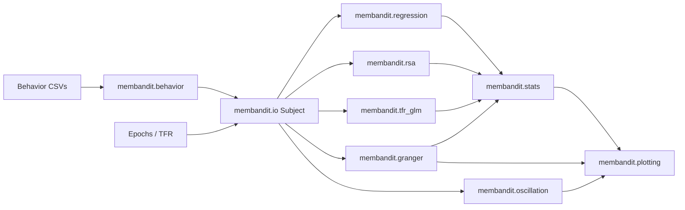

# Analysis Guide — MemoryBandit EMU (`cleaned_repo`)

This guide maps **analysis types** → **`membandit` modules / functions** → **curated notebooks** → **archive variants**.

Data root is configured via `MEMORYBANDIT_DATA_DIR` (default `/Volumes/T7 Shield`). See `membandit.paths`.

---

## 1. Behavior / RL & DDM

**What:** Load and preprocess EMU / Prolific behavior tables; fit RL models; optional DDM/Stan.

**Modules / functions:**
- `membandit.behavior`: `load_behavior_tables`, `preprocess_learn_df`, `preprocess_combined_df`, `normalize_rpe_cat_labels`, `resolve_trial_for_event`
- `membandit.paths`: `get_emu_behavior_dir`, `get_subjects_xlsx_path`
- DDM (archive): `archive/ddm/*.stan`

**Curated notebooks:**
- `notebooks/ProlificSubjectsBehavior_Processing-Delay.ipynb`
- `notebooks/MemoryBanditsEMU_Behavior.ipynb`
- `notebooks/EMU_Behav.ipynb`

**Archive:** `archive/ddm/`, `archive/notebooks/behavior_ddm/`

**External deps:** Bayesian model modules (`external/bayes_models/`); CmdStan for DDM.

---

## 2. Bayesian regression

**What:** Hierarchical / mixed-effects Bayesian GLMs relating behavior and memory (Bambi/PyMC).

**Modules:** mostly notebook-local + `membandit.behavior` for tables.

**Curated:** `notebooks/BayesianRegression.ipynb`

**Archive:** `archive/notebooks/behavior_ddm/BayesianRegressionProlific.ipynb`

**External deps:** `pymc`, `bambi`, `arviz`; lab Bayesian modules.

---

## 3. Cohort / electrode summary

**What:** Participant inclusion, electrode coverage, ROI counts for tables/figures.

**Modules:** `membandit.paths`, `membandit.behavior`; electrode tables via `Subject` / local CSVs.

**Curated:** `notebooks/MemoryBandit-ParticipantElectrodeSummary.ipynb`

---

## 4. TFR & spectral visualization

**What:** Compute/save Morlet TFRs; example TFR plots and statistics.

**Modules:**
- `membandit.io.Subject` (TFR cache)
- `membandit.tfr_glm`: `TFRClusterPermutationGLM`, `process_subject_tfr_cluster_glm`, `run_batch_tfr_cluster_glm_pipeline`

**Curated:** `notebooks/MemoryBandit-TFRPlotsAndStatistics.ipynb`

**Archive:** `archive/notebooks/tfr_spectral/`

**External deps:** `mne`; optionally `LFPAnalysis` for some cells.

---

## 5. Oscillation PSD / FOOOF / BOSC

**What:** ROI spectra, FOOOF peaks, theta/alpha burst prevalence vs RPE.

**Modules:**
- `membandit.oscillation`: `run_roi_oscillation_comparison`, `compute_subject_roi_oscillation_features`, `plot_roi_*`
- `membandit.extras.bosc`: `run_subject_event_bosc`, `plot_time_resolved_bosc`, `plot_period_averaged_bosc`

**Curated:** `notebooks/MemoryBandit_ROI_OscillationComparison.ipynb`

**Archive:** `archive/notebooks/oscillation_psd_fooof/`

**External deps:** `fooof`, `neurodsp`; **BOSC requires `LFPAnalysis`** (lazy-imported).

---

## 6. Time-resolved & MV/UV regression

**What:** Time-resolved HFA regression; multivariate / univariate encoding pipelines.

**Modules:**
- `membandit.regression`: `process_subject_smoothed_regression`, `run_smoothed_time_resolved_*`, `tune_alpha_*`, residualizers
- `membandit.io.Subject`

**Curated:** (manuscript uses encoding via HFA RSA template; see §7–8)

**Archive:** `archive/notebooks/timeresolved_regression/`, `archive/notebooks/mv_uv_reactivation/MVRegressionAndProjection.ipynb`, `UVRegressionAndProjection.ipynb`

---

## 7. Encoding / reactivation

**What:** Fit RPE encoding on feedback HFA; project onto cue for reactivation / reinstatement indices.

**Modules:**
- `membandit.regression`: `fit_encoding_model`, `compute_time_resolved_reactivation`, `compute_subject_*_reactivation`, `run_*_reactivation_pipeline`, `collapse_reactivation_feedback_windows`
- `membandit.extras.mvpa`: RPE-category crossnobis / LDA projection (optional)

**Curated:** `notebooks/HFA_RPE_RSA_MVTemplate.ipynb`, `notebooks/MemoryBandit-ACC_Reinstatement_SubjectCovariates.ipynb`

**Archive:** `archive/notebooks/mv_uv_reactivation/`

---

## 8. RSA & reinstatement

**What:** Cross-temporal / cross-region RSA; trial reinstatement; phase-state RSA.

**Modules:**
- `membandit.rsa`: `compute_cross_temporal_rsa_from_hfa`, `run_group_crossregion_rsa_pipeline`, `compute_trial_reinstatement_index`, `compute_acc_hpc_phase_rsa_at_cue`, …

**Curated:** `notebooks/HFA_RPE_RSA_MVTemplate.ipynb`, `notebooks/MemoryBandit-ACC_HPC_HitsRSA_GC_RPE.ipynb`

**Archive:** `archive/notebooks/rsa/`

---

## 9. MVPA / decoding / MI

**What:** Time-resolved RPE-category MVPA; multivariate mutual information / MIC.

**Modules:**
- `membandit.extras.mvpa`
- MATLAB: `matlab/test_script_*decoding*.m` (MVPA-Light)

**Curated:** (Python decoding panels largely in `HFA_RPE_RSA_MVTemplate.ipynb`; MATLAB scripts under `matlab/`)

**Archive:** `archive/notebooks/mvpa_decoding_mi/`

**External deps:** MVPA-Light / FieldTrip for MATLAB scripts.

---

## 10. Granger causality

**What:** Multivariate spectral GC stratified by RPE / reward / hit–miss; mixed-effects summaries.

**Modules:**
- `membandit.granger`: `compute_multivariate_gc`, `build_rpe_trial_map`, `process_subject_gc_rpe`, `run_or_load_subject_gc_rpe_df`, `fit_mixed_effects_rpe`, `plot_aggregate_rpe`, …

**Curated:** `notebooks/MemoryBandit-MultivariateGrangerCausality_RPE.ipynb`, `notebooks/MemoryBandit-ACC_dmPFC_Reinstatement_GC_RPE.ipynb`, `notebooks/MemoryBandit-ACC_HPC_HitsRSA_GC_RPE.ipynb`

**Archive:** `archive/notebooks/granger/`

**External deps:** `mne-connectivity`.

---

## 11. PAC (phase–amplitude coupling)

**What:** Within- and cross-region PAC; multivariate Gaussian-copula PAC; cluster GLM.

**Modules:**
- `membandit.tfr_glm`: `process_subject_*_pac_cluster_glm`, `run_batch_*_pac_cluster_glm_pipeline`
- Notebook-local tensorpac usage in archive PAC notebooks

**Curated:** `notebooks/MemoryBandit-CrossRegionMV-GCPAC.ipynb`

**Archive:** `archive/notebooks/pac/`

**External deps:** `tensorpac`; optionally `LFPAnalysis`.

---

## 12. Connectivity (wPLI / PSI / coherence)

**What:** Phase-based connectivity metrics across ROIs / retrieval.

**Modules:** primarily notebook-local + `membandit.granger` / `membandit.io` helpers for epochs/ROI selection.

**Curated:** none (not in manuscript core)

**Archive:** `archive/notebooks/connectivity/`

---

## 13. Ripple detection

**What:** Hippocampal ripple detection and behavior linkage.

**Modules:** notebook-local + `membandit.behavior` / `membandit.io`

**Curated:** `notebooks/MemoryBandit-HippocampalRippleDetection.ipynb`

**External deps:** often `LFPAnalysis`.

---

## 14. Integration / correlation hubs

**What:** Subject-level correlations across decoding, GC, RSA, MI outputs.

**Modules:** consume CSVs from §§7–10; plotting via `membandit.plotting` / seaborn.

**Curated:** `notebooks/MemoryBandit-ACC_dmPFC_Reinstatement_GC_RPE.ipynb`, `notebooks/MemoryBandit-ACC_HPC_HitsRSA_GC_RPE.ipynb`

**Archive:** `archive/notebooks/integration/`

---

## 15. Stats helpers (cross-cutting)

**Modules:**
- `membandit.stats`: cluster tests, `electrode_likelihood_ratio_test`, multinomial LRT maps, `compute_null_stats_one_sided`
- `membandit.plotting`: shared `plot_*` re-exports
- `membandit.plotting_style.set_plot_style`

---

## Figure → notebook mapping (manuscript)

| Manuscript | Panels | Notebook |
|------------|--------|----------|
| Fig 1 | B, C, S1 | `notebooks/ProlificSubjectsBehavior_Processing-Delay.ipynb` |
| Fig 1 | F | `notebooks/BayesianRegression.ipynb` |
| Fig 2 | A–D | `notebooks/MemoryBanditsEMU_Behavior.ipynb`, `notebooks/EMU_Behav.ipynb` |
| Fig 2 | D | `notebooks/BayesianRegression.ipynb` |
| Fig 2 | E, F; Table 2 | `notebooks/MemoryBandit-ParticipantElectrodeSummary.ipynb` |
| Fig 3 | A | `notebooks/MemoryBandit-TFRPlotsAndStatistics.ipynb` |
| Fig 3 | B–D; S2, S3, S5 | `notebooks/HFA_RPE_RSA_MVTemplate.ipynb` |
| Fig S4 | | `notebooks/MemoryBandit-HippocampalRippleDetection.ipynb` |
| Fig 4 | A–C | `notebooks/HFA_RPE_RSA_MVTemplate.ipynb` |
| Fig 4 | D, S6 | `notebooks/MemoryBandit-ACC_Reinstatement_SubjectCovariates.ipynb` |
| Fig 5 | A–C | `notebooks/MemoryBandit_ROI_OscillationComparison.ipynb` |
| Fig 5 | D, S7 | `notebooks/MemoryBandit-MultivariateGrangerCausality_RPE.ipynb` |
| Fig 5 | E | `notebooks/MemoryBandit-ACC_dmPFC_Reinstatement_GC_RPE.ipynb` |
| Fig S8 | | `notebooks/MemoryBandit-CrossRegionMV-GCPAC.ipynb` |
| Fig 6 | A–C; S9–S11 | `notebooks/MemoryBandit-ACC_HPC_HitsRSA_GC_RPE.ipynb` |

---

## Package layout cheat-sheet

| Module | Role |
|--------|------|
| `membandit.paths` | Data-root configuration |
| `membandit.behavior` | Canonical behavior I/O + `rpe_cat` |
| `membandit.io` | `Subject`, epochs, ROI loaders |
| `membandit.regression` | Encoding / reactivation / time-resolved regression |
| `membandit.rsa` | RSA / reinstatement |
| `membandit.tfr_glm` | TFR & PAC cluster GLM |
| `membandit.granger` | MVGC pipelines |
| `membandit.oscillation` | PSD / FOOOF ROI comparison |
| `membandit.stats` | Cluster / LRT helpers |
| `membandit.plotting` | Shared plots |
| `membandit.plotting_style` | Figure style |
| `membandit.extras.bosc` | BOSC (needs LFPAnalysis) |
| `membandit.extras.mvpa` | RPE-category MVPA utilities |
| `membandit._impl.*` | Full source implementations (facades re-export from here) |
